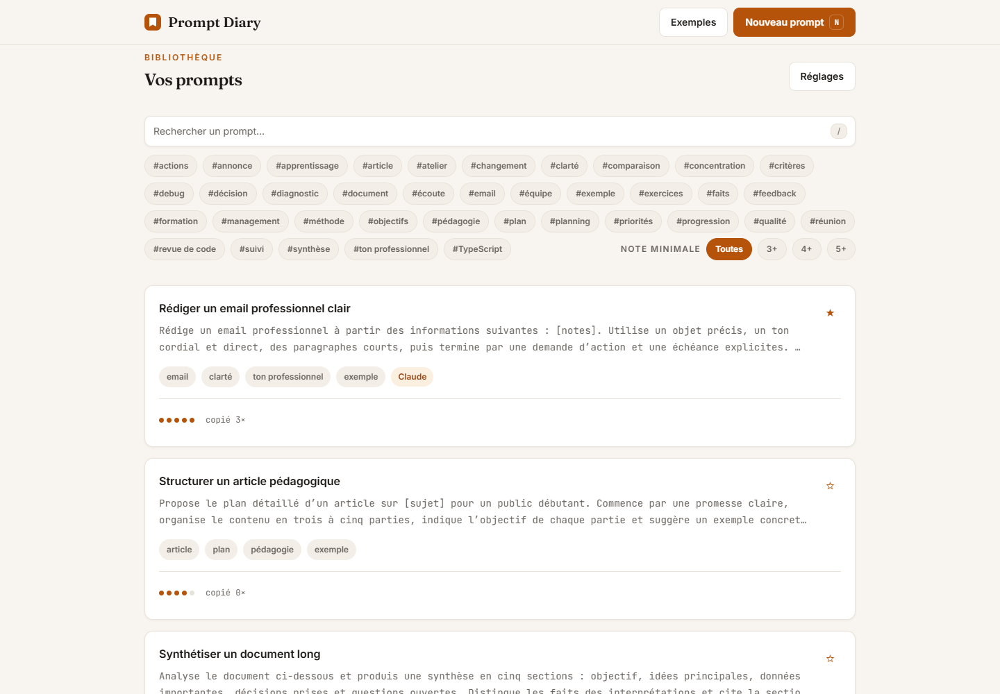
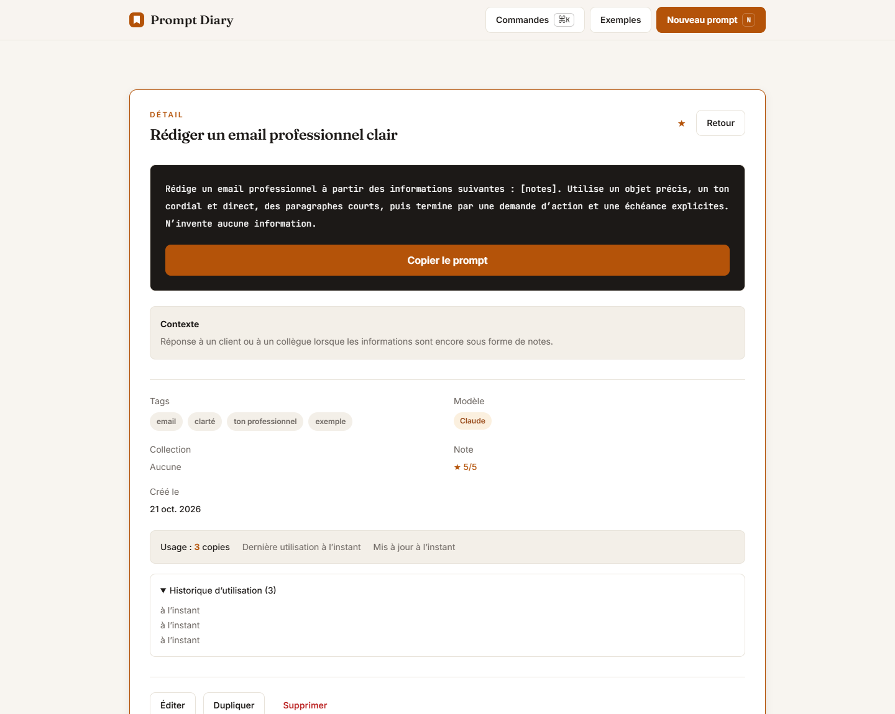
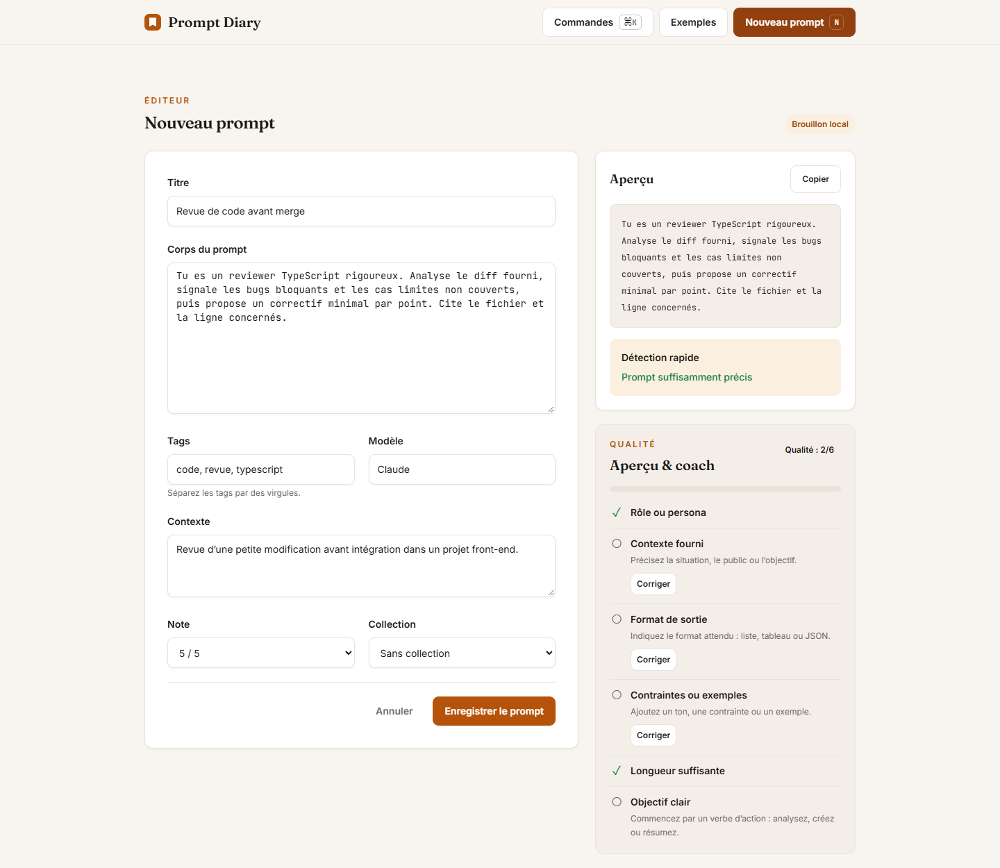

# Prompt Diary

[](https://github.com/giztariq/PromptDiary/actions/workflows/ci.yml)
[](LICENSE)

Journal local-first de prompts : sauvegardez ce qui fonctionne, notez-le, retrouvez-le et réutilisez-le. Pas de compte, pas de backend, pas de synchronisation cloud.



## Ce que fait l'application

- **Bibliothèque de prompts** avec titre, corps, tags, modèle, contexte et note de 1 à 5.
- **Variables dynamiques** `{{client}}`, `{{ton}}` : saisie au moment de l'usage, valeurs mémorisées par prompt.
- **Coach qualité** pendant la rédaction et badge « À préciser » sur les prompts trop vagues.
- **Recherche instantanée** insensible à la casse et aux accents, sur le titre, le corps, les tags, le modèle et le contexte.
- **Palette de commandes** `Ctrl/Cmd + K` pour créer, ouvrir un prompt ou rejoindre une vue, avec navigation aux flèches.
- **Garde-fou brouillon** : confirmation avant de quitter un prompt modifié, y compris à la fermeture de l'onglet.
- **Filtres** par tags et note minimale, favoris remontés en premier.
- **Historique d'usage** : 10 dernières utilisations conservées, 5 affichées dans le détail, compteur de copies.
- **12 exemples** prêts à importer, avec leur tag source.
- **Import / export JSON** versionné, avec fusion sans doublon et reprise propre si un import échoue en cours de route.
- **100 % local** : IndexedDB, aucune requête réseau à l'exécution.
- **Accessibilité AA** : navigation clavier, focus visibles, modale avec piège de focus, contrastes vérifiés.
- **Installable et hors ligne** après la première visite (manifest + service worker en production).

| Détail et historique d'usage                       | Éditeur et coach qualité                          |
| -------------------------------------------------- | ------------------------------------------------- |
|  |  |

## Démarrage

Prérequis : Node.js `24.19.0` (voir `.nvmrc`) et npm.

```bash
npm ci
npm run dev
```

Ouvrir l'URL affichée par Vite, généralement <http://localhost:5173>.

## Vérifications

```bash
npm run verify
```

Cette commande enchaîne, dans l'ordre :

1. `format:check` — Prettier ;
2. `typecheck` — TypeScript strict ;
3. `lint` — ESLint ;
4. `test` — Vitest, adaptateur mémoire et `fake-indexeddb`, sans réseau ;
5. `build` — build statique de production.

Les commandes sont aussi disponibles séparément : `npm run format`, `npm run typecheck`, `npm run lint`, `npm test`, `npm run build`.

La CI GitHub Actions exécute `npm run verify` sur chaque push et pull request. Un second job construit l'image Docker de test et lance la suite **sans réseau** (`docker run --network none`).

## Production locale

```bash
npm run build
npm start
```

`npm start` sert `dist/` avec un petit serveur Node sans dépendance (`scripts/serve.mjs`), avec fallback SPA et en-têtes de cache adaptés. Ouvrir <http://localhost:4173>.

## Docker

```bash
docker build -t prompt-diary .
docker run --rm -p 4173:4173 prompt-diary
```

L'image finale ne contient que le build et le serveur statique, et tourne avec l'utilisateur non privilégié `node`.

Pour rejouer la vérification hors ligne :

```bash
docker build --target test -t prompt-diary-test .
docker run --rm --network none prompt-diary-test npm test
```

## Architecture

```text
src/
  domain/      types, recherche, scoring, détection de prompts vagues, variables,
                création, import/export, actions — fonctions pures testées
  storage/     StorageAdapter, adaptateur IndexedDB, adaptateur mémoire, contrat partagé
  ui/          composants React et styles applicatifs, sans logique métier
  test/        setup Vitest et contrat de stockage réutilisable
  styles/      tokens de design et styles globaux
public/        favicon, icônes PWA, manifest, robots.txt, service worker
scripts/       serveur statique de production sans dépendance
.github/       workflow CI
Dockerfile     étapes dependencies / test / build / runtime
```

Règles structurantes :

- `domain/` et `storage/` sont testés avant intégration ; l'UI ne contient pas de règle métier.
- Le même contrat de stockage (`src/test/storageContract.ts`) s'exécute sur l'adaptateur mémoire et sur IndexedDB.
- Aucun appel réseau dans l'application ni dans les tests.
- Pas de `any`, pas de `@ts-ignore`, pas de dépendance sans nécessité démontrée.

## Données et vie privée

Les prompts et les valeurs de variables vivent dans la base IndexedDB `prompt-diary` (version 2) du navigateur. Rien n'est envoyé à un serveur. Un export JSON depuis **Réglages** sert de sauvegarde ; l'import fusionne les prompts existants sans écraser les identifiants déjà présents.

Limites assumées : une bibliothèque par profil de navigateur, pas de comptes, pas de synchronisation multi-appareils. Effacer les données du site efface la bibliothèque : gardez un export JSON.

## Parcours de démo (2 minutes)

1. Ouvrir **Exemples**, puis **Tout ajouter**.
2. Rechercher `analyse`, filtrer sur `5+`, ouvrir un prompt.
3. Le copier : le toast confirme, le compteur et l'historique d'usage se mettent à jour.
4. Utiliser un prompt à variables, remplir `{{client}}`, copier : les valeurs sont mémorisées à la réouverture.
5. Créer un prompt vague et vérifier le badge **À préciser** et le coach qualité.
6. Exporter la bibliothèque depuis **Réglages**, puis la réimporter.

## Licence

[MIT](LICENSE) © 2026 C. Tariq.
